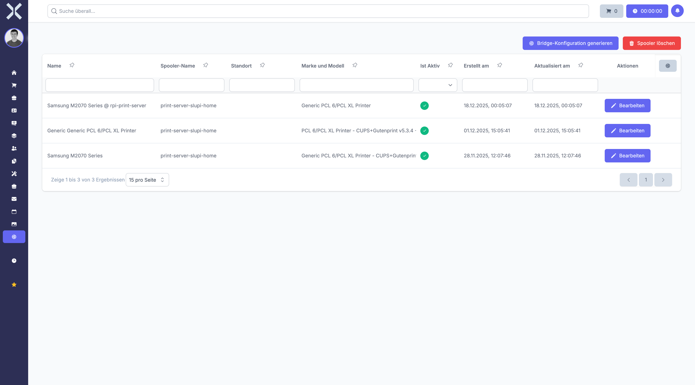

# Printers

The printer settings list every printer connected through a Printer Bridge and control which of them appear in selection lists.

## How a printer gets into the system

Printers are not created by hand. They come from the **Printer Bridge**, a small program on a computer in your network (for example a mini PC or Raspberry Pi) that runs the **CUPS** print service.

- Every print queue in CUPS becomes a printer in the system.
- The bridge checks its queues at a fixed interval (default: every 5 minutes). It creates printers for new queues, updates changed ones and deletes removed ones.
- A printer's paper sizes come from its driver in CUPS and cannot be edited in the system.
- All printers of a bridge carry its instance name as **Spooler**.

This means:

- **Adding a printer:** create a queue in CUPS on the bridge computer. Printers that announce themselves on the network (driverless IPP) are usually added by CUPS automatically. Label printers and older devices need a driver on the bridge computer.
- **Missing paper size:** add the size to the printer's driver in CUPS. It shows up after the bridge's next check.
- **Replacing a printer:** change the address of the existing queue in CUPS to the new device. The printer keeps its alias and user assignments. A new queue becomes a new printer without assignments.
- **Removing a printer:** delete the queue in CUPS. If you only delete the printer in the system, the bridge creates it again on its next check. To just stop offering a printer, make it invisible.

## Open Printers

1. Navigate to **Settings > System > Printers**.

   

2. The table shows the printers of all bridges: name, alias, spooler, location, model, active and visible.

## Edit a Printer

1. Click **Edit** in the printer's row.
2. Change the **Alias** or toggle **Visible**.
3. Click **Save**.

Nothing else about a printer can be set here, everything else comes from CUPS.

## Delete a Printer

Click **Delete** in the printer's row and confirm. As long as the queue still exists in CUPS, the bridge creates the printer again on its next check.

## Assign Printers to Users

When printing, each user is offered only the printers assigned to them. Assignment happens on the user, not on the printer:

1. Navigate to **Settings > Users & Permissions > Users** and open the user.
2. Select every printer the user should use in the **Printers** field.
3. Below it, choose the **Default Printer** and **Default Size**. Both are preselected in the print dialog.
4. Save the user.

> **Note:** The **Printers** field only offers printers that are active and visible. Hide unneeded printers first, then assign.

## Generate Bridge Config

1. Click **Generate Bridge Config**.
2. Enter a unique **Instance Name**. It becomes the spooler of all printers of this bridge.
3. Adjust the check intervals, API port and WebSocket option if needed.
4. Click **Generate Configuration** and copy the result into the bridge's configuration.

The configuration contains an API token the bridge signs in with. If a token for the instance name already exists, the system asks before regenerating it. A new token invalidates the old one, and the bridge then needs the new configuration.

## Delete Spooler

Click **Delete Spooler**, select the spooler and confirm. This deletes all printers of that spooler and invalidates its API token.

## Troubleshooting

- **Printer missing from the list:** check that a queue exists in CUPS on the bridge computer and that the bridge is running. New queues appear after the next check.
- **Printer missing for a user or in the print dialog:** check that it is active, visible and assigned to the user.
- **Paper size missing:** the size is missing from the printer's driver in CUPS and has to be added there.
- **Print jobs stay open:** the bridge is not running or cannot reach the system, the printer is off or unreachable from the bridge computer, or the CUPS queue is paused. See [Print Jobs](55-print-jobs.md).

## Related Topics

- [Print Jobs](55-print-jobs.md) - View print jobs
- [Users](16-users.md) - Manage users
- [Settings](0-index.md) - Back to the settings overview
